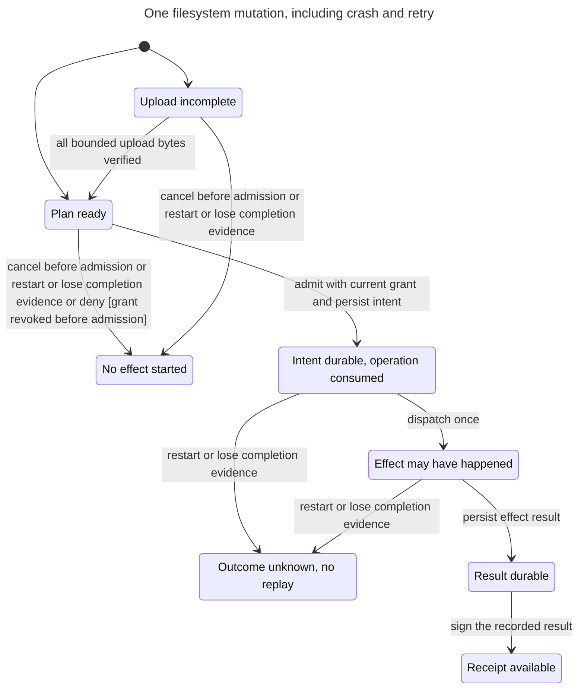

# NIC-118 host filesystem Child and Mother application design

Status: proposed design, not implementation or deployment approval.

Goal: let people and bots browse host folders through Mother, then add bounded
moves, writes, and recoverable deletion. The first deployment is a Mother
container on nica-unraid. The same FS Child must work on a Pi with local folders,
without ZFS, SMB, a browser, or another Mother.

Recommendation: one local Mother, one filesystem-agnostic Wasm Child, and a
`host-fs` Toy. Use standard read-only WASI preopens for reads. Add narrowly
authorized mutation operations where WASI does not express application policy.
Keep ZFS administration outside both the Child and the Mother container.

## 1. Parts list and architecture

### Evidence boundary

Code was inspected at `bc48d1e0d721d1531a58192a69ef65ffd234882f`, this branch's
starting revision. The following newer planning documents were read without
merging their branches. Their interfaces are proposals, not installed features.

| Source | Constraint carried into this design |
| --- | --- |
| [NIC-118 body and three comments](https://linear.app/nicabar/issue/NIC-118) | Generic `host-fs`, named roots, identity-bound grants, library-based UI, read-only first. Comments report no automatic vault snapshots. Do not assume that has changed. |
| [Vision/Child plan at ecbb94a](https://github.com/nicabarnimble/patina-mct/blob/ecbb94af767346518ea47ae850d732cf98aa33c0/docs/mct-vision-child-plan.md) and [NIC-104 locked decisions](https://linear.app/nicabar/issue/NIC-104) | Bounded operations; separate owner, node, Vision, membership, and grants; D-58 runtime cutover; no recovery milestone or write-capable cross-Vision access. |
| [D-52](../DECISIONS.md#d-52-finish-independent-mothers-and-bounded-federation-together) | The checked-in decision still says one local Vision. NIC-104 explicitly approves amending it to multiple memberships. Approved direction is not an implemented membership set. |
| [NIC-109](https://linear.app/nicabar/issue/NIC-109) and [NIC-110 shared contract at 5486458](https://github.com/nicabarnimble/patina-mct/blob/5486458dab6ec760caa89995532eb7aa1a585035/docs/design/small-device/nic-110-shared-contract.md) | Pi 3 first, bounded calls, signed receipts, trusted precompiled components, honest interruption and offline result delivery. Reuse the shared contract rather than create a second receipt format. |
| [NIC-111 health at 7ca24c0](https://github.com/nicabarnimble/patina-mct/blob/7ca24c04fa568682de5bd7e9a9c2186c82420981/docs/design/small-device/nic-111-health-probe.md) | Logical host resources and structured unavailable/stale results. Storage telemetry does not imply pool administration. |
| [NIC-112 logs at 41d287a](https://github.com/nicabarnimble/patina-mct/blob/41d287afe92ef97b3f2438b0b13277668907120a/docs/design/small-device/nic-112-log-journal-summary.md) | Bound reads of mutable sources; report incomplete coverage and changed sources. No unbounded filesystem scan. |
| [NIC-113 config at 9bd7977](https://github.com/nicabarnimble/patina-mct/blob/9bd7977720bd912ec25dd6537c208810ebfac625/docs/design/small-device/nic-113-config-preflight-drift.md) | Preserve directory-read compatibility; immutable input digests are stronger than live-file metadata checks. |
| [NIC-114 watcher at 28d2155](https://github.com/nicabarnimble/patina-mct/blob/28d21551f9f903eed6ae1737a7c7a85c37a025ab/docs/design/small-device/nic-114-threshold-watcher.md) | A durable checkpoint/outbox is new work. Do not make the FS Child an always-running watcher or confuse SQLite projection writes with a ledger transaction. |
| [NIC-115 gateway at 8daf61e](https://github.com/nicabarnimble/patina-mct/blob/8daf61e190630aaeaebecc81b8a412cbc90c2811/docs/design/small-device/nic-115-sensor-gpio-mcu-gateway.md) | Host-specific drivers stay behind a Toy. A host helper or MCU is not another Mother. |
| [NIC-116 action at d9f277e](https://github.com/nicabarnimble/patina-mct/blob/d9f277e3942386871a6e22aa07fa630af4e14e1e/docs/design/small-device/nic-116-guarded-service-action.md) | Plan is not permission. Consume a stable effect identity before dispatch; uncertain completion never causes an automatic retry. |

The current request selects the container topology. It does not authorize a live
deploy, UID/GID selection, network exposure, or SMB permission changes. Existing
guest-writable SMB can bypass Mother and race its operations. Mother can audit
MCT-mediated access, not every access to those files.

### Existing call path

Mother authenticates ingress, constructs `MctCall`, filters authority before
ranking routes, and revalidates the selected Child. Artifact, approval,
assignment, and instance remain four separate facts. A manifest need grants
nothing. Kernel grant evaluation produces `AuthorizedToyCall`; the adapter
admits the effect against current authority. The ledger owns evidence, while
SQLite stores reconstructible projections and runtime data.

The ordinary directory-read adapter in
[`resident/execution.rs`](../../crates/mct-daemon/src/daemon/resident/execution.rs)
currently maps one trusted `file://` root to `/project`. It installs a read-only
preopen through [`wasm.rs`](../../crates/mct-daemon/src/wasm.rs). It does not
provide named user roots, OIDC subject grants, a file transfer API, or safe
write-without-delete authority.

### Required inventory

All entries marked new are proposed. Optional entries do not block read-only
use. Instance paths, identities, hostnames, issuer URLs, and dataset names belong
in private deployment configuration, not application source or packaged defaults.

| Part | Owner and contract | Status and delivery |
| --- | --- | --- |
| Mother runtime | `mct-daemon`, `mct-kernel`, `mct-observation`, and `mct-iroh` | Existing. Reuse call law, authority ordering, ledger verification, artifact admission, and Wasmtime. New integrations are listed below. |
| FS Child | Proposed `crates/mct-fs-child`, package `mct:filesystem@0.1.0-draft`, world `child` | New Rust Wasm component. List, stat, read-range, and later mutation orchestration. No native path, ZFS, shell, OIDC, or Docker dependency. |
| Shared filesystem values | Proposed `mct:fs-types@0.1.0-draft` | New WIT schema for root IDs, relative names, metadata, pages, plans, and safe errors. Type dependencies confer no authority. |
| `host-fs` Toy | Proposed `toy:mct:host-fs`, `mct:host-fs@0.1.0-draft` policy and mutations interfaces | New canonical catalog/grant contract. Read delegation uses WASI; mutation host methods enforce the additional semantics. Separate actions, exact resources, no wildcard roots. |
| Filesystem host adapter | Proposed optional `crates/mct-host-fs` | New native capability adapter. Owns enrolled directory handles, root revisions, bounded staging, mutation records, and trash metadata. Uses Wasmtime WASI confinement and cap-std directory-relative operations, not a custom path resolver. |
| Standard component imports | `wasi:filesystem/types`, `wasi:filesystem/preopens`, and when used `wasi:io/streams`, `wasi:io/error`, all pinned to `0.2.3` initially | Existing runtime baseline. Do not import an entire command world, sockets, environment, random, or clocks merely for convenience. Any compiler-added import needs review. |
| Shared result/receipt schema | `patina:small-device@0.1.0-draft` from NIC-110 | Proposed dependency. Mother signs an audience-safe result; the FS Child never holds receipt keys. Read-only delivery needs the bounded result/signing subset, not fleet fan-out. |
| Principal admission | Proposed Mother ingress module plus versioned kernel principal binding | New. Translate an authenticated OIDC subject or enrolled bot credential into locally approved call authority. Bind it through routing, Toy admission, dedupe, and result access. |
| HTTP adapter | Proposed `mct-fs-http`, a thin trusted adapter to ordinary Mother calls | New. Serves only the FS Child's operations and bounded transfer responses. No filesystem mounts, admin routes, or filesystem implementation in this service. |
| Identity edge | Existing Pocket ID, TLS reverse proxy, and an OIDC relying-party/session service | Deployment integration is new. Pocket ID is an OIDC provider, not itself a Caddy `forward_auth` endpoint. Use a reviewed OIDC adapter or dedicated relying party. |
| UI/provider | Two-pane library UI and one typed Child-API provider | New static asset bundle. No direct SMB, WebDAV, host directory, or ZFS connector. Bots use the same API without the UI. |
| Root enrollment/config | Mother-private versioned root map and D-58-authorized enrollment/revocation records | New. Map logical roots to pinned mounts/handles and bind policy revisions. Keep private authority state outside every granted root. |
| Mutation journal/staging | Mother-owned ledger facts, SQLite projection, private per-root staging/trash area | New before moves. These are Toy implementation data, not an exposed keyvalue/SQL Toy. Upload bytes are bounded disk staging, not stored in the ledger. |
| Receipt key/result storage | Mother-private enrolled receipt key, canonical envelope blobs, bounded outbox and replay tombstones | New NIC-110 subset. Separate signer role from admin and builder keys. Reserve storage before admission. |
| ZFS query Toy/helper | Optional `mct:zfs-query@0.1.0-draft` and host helper | New later. Structured read-only pool/dataset information. No `/dev/zfs` or Docker socket in Mother. See section 4. |
| ZFS report Child | Optional separate leaf `mct:zfs-report@0.1.0-draft` | New only when classification/history/report composition is useful. Not required to list files or keep snapshots. |
| Child release bundle | `.wasm`, `child.toml`, integrity sidecars, WIT dependency lock, import/export inventory, budgets, provenance, allow/deny fixtures | New package using the current package-relative layout. Exact approval still names the artifact. |
| AOT artifacts | Target-specific `.cwasm` and signed derivation manifest | New trusted loader pipeline from NIC-110. Pin portable digest, compiled digest, CPU floor, Wasmtime build/configuration, and WIT/manifest digests. No compile fallback on Pi 3. |
| Mother deploy bundle | Immutable OCI image, image digest/signature, SBOM, release notes, supported-state-schema range, Compose/Unraid template, health probe | New container product path. Qualify the actual Unraid CPU architecture; add Linux x86-64 packaging if needed. Existing supported Linux evidence is ARM64. |
| Host lifecycle artifacts | Persistent private state volume, exact dataset bind mounts, restart policy, start-after-mount checks, upgrade/rollback and backup/restore procedures | New container integration. The Pi alternative uses a full-runtime systemd unit, not the current admin-only unit unchanged. |
| Release/update service | CI-built artifacts and an operator-controlled update check/apply procedure | Extend existing release tooling. No floating `latest`, automatic schema downgrade, or silent artifact approval. |

A writable root eventually needs a writable mount in the Toy's host process,
but the Child still receives only a read-only preopen. The container runs as a
fixed unprivileged UID/GID with no added capabilities, a read-only image, bounded
tmpfs, and only the enrolled data/state mounts. Never mount `/`, `/mnt`, the
Docker socket, or the whole pool for convenience. Bind the selected dataset
directly, not the Unraid user-share layer. Keep the HTTPS ingress private until
its exposure review passes. Configure boot activation and missing-mount failure
explicitly; Docker must not create an empty substitute directory.

### Architecture candidates and synthesis

The `/architect` comparison used two structurally different candidates. No
multi-model runner was available in this session, so this is a single-reviewer
comparison, not independent consensus.

| Criterion | A. Direct read/write WASI preopens | B. Read-only WASI plus guarded mutations |
| --- | --- | --- |
| WASI reuse | Excellent for standard reads and writes. | Same standard reads; native capability operations implement only extra mutation policy. |
| Permission tiers | Fails with stock `FsPerms::ReadWrite`, which includes unlink and replacement. | Host retains write authority; separate move, write, and delete checks are enforceable. |
| Recovery/receipts | Requires interception of every destructive WASI entry point and descriptor-derived stream. | One effect-journal boundary owns intent, staging, commit, and reconciliation. |
| API depth | Small guest API, but application semantics leak into a large custom WASI implementation. | More domain methods, but callers do not coordinate OS handles, locks, fsync, or trash rules. |
| Isolation from existing Children | Changing global WASI semantics risks fixture behavior. | New Toy and opt-in adapter leave ordinary `/project` and legacy delegated preopens unchanged. |

Choose B. Retain A's standard WASI reads and resources. Reject raw writable
preopens even for read-write+delete; they would bypass recoverable-delete and
receipt rules. A generic all-purpose file RPC service would duplicate WASI and
turn the Child into an unnecessary proxy. B instead adds application mutation
semantics that WASI does not define. It accepts more host code in exchange for
one enforceable write boundary.

### Caller usage and module sketch

The caller sees logical roots and safe relative names only. For example:

```text
roots() -> [{id: "documents", access: read}]
list({root: "documents", path: [], cursor: none}) -> bounded entries
stat({root: "documents", path: ["notes.txt"]}) -> metadata + version
read-range(entry, version, offset, count) -> bytes + observed version + receipt
plan(rename(entry, destination, expected-version), operation-id) -> plan
apply(plan-id) -> effect status + receipt, subject to fresh authority
```

A write plan also declares total size and content digest. `put-chunk` fills its
private staging object at checked offsets. `apply` publishes only a complete,
verified object. A plan or upload token identifies work; neither authorizes it.

Proposed Rust boundaries, shown as signatures rather than implementation:

```rust
// mct-kernel: authority data only, no Wasmtime, OIDC SDK, path or database types.
struct AuthenticatedPrincipal { issuer_id: IssuerId, subject_id: SubjectId }
struct FsGrantBinding { principal: PrincipalId, assignment: ChildAssignmentId,
                       root: RootId, root_revision: u64, actions: FsActions }
fn authorize_fs_effect(call: &MctCall, binding: &FsGrantBinding,
                       current: &LocalExecutionAuthoritySnapshot)
    -> Result<AuthorizedToyCall, FsAdmissionDenied>;

// mct-host-fs: private capability handles and persistence behind one API.
struct HostFs { /* root handles, bounded staging, effect index, ledger port */ }
fn prepare(&self, authority: AuthorizedToyCall, intent: MutationIntent)
    -> Result<Plan, FsError>;
fn put_chunk(&self, authority: AuthorizedToyCall, plan: PlanId,
             offset: u64, bytes: &[u8]) -> Result<UploadProgress, FsError>;
fn apply(&self, authority: AuthorizedToyCall, plan: PlanId)
    -> Result<EffectStatus, FsError>;
fn lookup(&self, authority: AuthorizedToyCall, operation: OperationId)
    -> Result<EffectStatus, FsError>;
```

These newtypes and functions do not exist today. `mct-fs-child` owns domain
request/result validation and standard WASI read behavior. `mct-host-fs` owns
native effects and their journal. Mother alone owns authorization and result
signing. The HTTP adapter owns transport/session parsing, not a second ACL
engine. Private adapter modules hide cap-std, SQLite, and Wasmtime types.

Boundary Discipline puts identity validation at ingress and effect authorization
at the existing kernel boundary. Make Operations Idempotent puts mutation identity
and reconciliation in one host owner, not in UI retries.

### UI library recommendation

Start the UI evaluation with two instances of
[Chonky](https://github.com/TimboKZ/Chonky), whose README describes keyboard
shortcuts, selection, drag/drop, and list/grid views. Its inspected license is
MIT. Adapt a typed provider to the Child API and add two-pane focus/operation
coordination. Chonky is React-based, so this is a deliberate exception to the
usual Datastar preference, justified by reuse rather than building a file manager.
Do not assume it already supplies complete Norton Commander semantics.

[elFinder](https://github.com/Studio-42/elFinder) is an alternative with a mature
connector model and BSD-3-Clause licensing. Its inspected README warns about
older public-server releases. Its broad PHP/connectors, archive execution, and
remote-storage features make it the worse starting dependency here. Do not
install its bundled backend or present it as the product.

Before choosing a pinned UI release, check maintenance, dependency advisories,
accessibility, keyboard-only two-pane use, large-directory behavior, and whether
all file actions can be disabled or routed through the provider. This is a
selection recommendation, not a completed security or usability evaluation.
Unsupported operations stay absent in both UI and API. File names are escaped
as text; downloads use safe disposition and `nosniff`. No active HTML preview,
archive extraction, external thumbnail URL, or automatic recursive size scan.

## 2. MCT gap analysis for a normal long-lived Mother

Severity means delivery dependency, not vulnerability score.

- **blocks piece 1** means required before the first identity-gated read-only
  container is called a usable application. Preparatory work may use fixtures.
- **blocks later** means read-only can ship without it, but a named later piece
  or the complete long-lived-app claim cannot.
- **nice-to-have** means not required for NIC-118's acceptance.

Piece 1 is the read-only application milestone in section 7. Existing evidence
is credited without treating macOS procedures or admin-only Linux tests as proof
of the full container runtime.

| Gap | Existing evidence | Missing work and owner | Severity |
| --- | --- | --- | --- |
| G01. Full-runtime container/install target | macOS launchd lifecycle; [Linux admin install](../linux-admin-install.md) uses Nix/systemd. | Mother release work must package the full resident runtime, qualify Unraid architecture, nonroot ownership, exact mounts, and a repeatable install/uninstall that preserves state. No container deployment artifacts exist at the inspected baseline. | **blocks piece 1** |
| G02. Start on boot and shutdown | Linux system unit can be enabled; forced process restart was tested. | Container restart/boot integration, dataset-mount prerequisite, signal forwarding, bounded drain, lock release, and host-reboot acceptance. No privileged container or systemd inside the image. Pi full-runtime unit needs separate qualification. | **blocks piece 1** |
| G03. D-58 administration of runtime authority | [Passkey guide](../passkey-admin.md) explicitly says admin-only mode and legacy runtime are separate. | Shared Mother work must admit this Child, root bindings, and grants through target-bound day-key administration with durable revocation. Pocket ID is user login, not an admin cutover workaround. | **blocks piece 1** |
| G04. End-user/bot identity | Local ingress binds `uid:<uid>`; `ToyGrantSubject` narrows by caller node, not OIDC subject. | Add a versioned principal binding and authenticated ingress contract. Preserve it in tokens, dedupe, result authorization, and receipts. Two browser users must not collapse to the proxy's UID/node. | **blocks piece 1** |
| G05. Named roots and root-scoped data policy | Directory-read supplies one canonical root at `/project`. | `host-fs` enrollment, root generation, principal/root/action checks, trusted classification, safe root enumeration, and mount-replacement refusal. | **blocks piece 1** |
| G06. Configuration ownership | `config.rs`, startup classification, ledger projection checks, and private-file checks exist. | Versioned container config validation, secret references, root-map reload rules, safe defaults, effective-config display, and migration policy. Authority edits must use admin commands, not mutable TOML as permission. | **blocks piece 1** |
| G07. Health/readiness | `status.rs` returns structured status, but readiness chiefly checks whether Iroh is bound and initializes health as healthy. | Report authority replay, ledger writability/reserve, required roots, Child readiness, signer, and exhausted I/O workers. Separate liveness from readiness and keep diagnostics private. | **blocks piece 1** |
| G08. Logs and evidence operations | Hash-chained observations, inspection, and metrics exist. | Container stdout/stderr routing, redaction, rotation/retention, disk-pressure alerts, and operator correlation by call/audit ID. Do not rotate or truncate the canonical ledger with a Docker log driver. | **blocks piece 1** |
| G09. State backup and restore | Startup/restart and SQLite-rollback tests exist. No inspected product procedure proves complete backup/restore. | Quiesced consistent backup of ledger, keys, root config, artifacts, required blobs, and projections. Verify restore in isolation, retain an external trusted ledger head, fence the old writer, and never clone a live Mother identity. | **blocks piece 1** |
| G10. Verified upgrade in place | Digest-exact macOS `upgrade`; [NIC-63 replacement evidence](../nic63-rolling-upgrade.md) covers distinct binaries in a test harness. | Operator-approved OCI/Nix replacement with drain, state-version preflight, backup, exact new image/Child approval, and post-start tests. Do not describe the existing Linux installer as an upgrader. | **blocks later** before ongoing service/update claim |
| G11. Rollback and schema compatibility | macOS retained-release rollback is documented; NIC-63 did not test downgrade. | Test previous binary plus retained compatible components against current state. Refuse incompatible downgrade; restore only under explicit incident procedure. Rolling back code must not roll back revocations, consumed effects, or ledger history. | **blocks later** before ongoing service/update claim |
| G12. Ongoing releases and security updates | Release scripts, version checks, SBOM/audit tooling, and CI exist. | Supported container/CPU matrix, authenticated update feed/check, release ownership, advisory triage, release cadence, compatibility policy, and staged operator approval. Automatic checks may notify; they must not silently activate code. | **blocks later** before ongoing service/update claim |
| G13. Signed application receipts and result retention | `MctResult.audit_ref` and ledger hashes exist; neither is a signed receipt per call. | Implement the NIC-110 signer/envelope/outbox subset, key enrollment/rotation, canonical bytes, capacity reservation, and authorized result reacquisition. | **blocks piece 1** |
| G14. Read/transfer budgets and cancellation | Guest deadlines, per-memory cap, and custom-host-call budgets exist. | Charge standard WASI file/stream operations, cap enumeration and aggregate memory, bound native blocking work, and backpressure HTTP. No assumption that epoch interruption stops a blocked read. | **blocks piece 1** |
| G15. Writable tiers and effect durability | Preopens offer ReadOnly/ReadWrite. Restart settles calls rather than resuming them. | Guarded mutations, stable operation IDs beyond the 12-minute call cache, append-before-dispatch, no-replace support, staging quotas, recovery, and safe errors. | **blocks later** before move/rename |
| G16. Recovery policy for destructive effects | No automatic vault snapshot schedule established by the issue comments. | Enrolled private trash and restore tooling, or verified pre-effect snapshot coverage/retention and restore drill. Replacement is destructive too. | **blocks later** before replacement/delete |
| G17. Trusted AOT and Pi resource profile | `compile_snapshot` uses `Component::from_binary`; default limit is 64 MiB per memory. | NIC-110 authenticated `.cwasm` loader/build pipeline, compatibility checks, aggregate memory, and actual Pi 3 measurements. | **blocks later** before Pi acceptance; not an Unraid read-only prerequisite |
| G18. Standard streaming across ingress | `wit_values.rs` rejects Own, Borrow, Future, and Stream at the JSON call boundary. | Keep bounded value/range calls first. Add a separately versioned resource-aware adapter only if needed; qualify WASI 0.3 async/stream support end to end before use. | **blocks later** for native streaming optimization |
| G19. Multi-Vision membership | NIC-104 approves the D-52 amendment; local identity/publication still use one Vision. | Shared runtime work must scope membership, assignment, storage, grants, and discovery independently. No cross-Vision file write in this design. | **blocks later** only when serving multiple Visions |
| G20. ZFS visibility/helper | No pool Toy or helper in the inspected runtime. | Host-owned structured query API, dataset enrollment, helper supervision, least OS privilege, freshness, and bounded failure. | **blocks later** for ZFS reporting/snapshot-policy automation |
| G21. UI/provider integration | No FS application UI exists. | Adapt the chosen library to Child operations, session/CSRF protection, safe downloads, pagination, and error states. A minimal read-only library view is enough initially. | **blocks piece 1** |
| G22. Second Mother/fleet coordination | Single-hop federation and receiver-local admission already exist. | No additional work is required for local FS access. Fleet fan-out, shared presentation, and remote data movement need separate grants and tests if requested later. | **nice-to-have** |
| G23. Search, previews, watches, HA | Existing Watch fixtures are compatibility evidence, not this application. | Indexing, preview decoders, live notifications, or failover require separate designs/capabilities. Guardian recovery remains outside NIC-104's milestone. | **nice-to-have** |

For G09, the initial safe backup procedure stops new calls, drains bounded work,
flushes the canonical writer, and backs up the private state root while stopped.
A ZFS snapshot can capture that root if it actually lives on ZFS. Otherwise use
an equivalent consistent copy. Copying a live SQLite main file without its WAL
is not a backup. Encrypt backups and protect signing/endpoint keys separately.
Restore first with network and effects disabled, verify the ledger and saved
head, reconstruct projections, and test that revoked grants remain denied.
A stale backup must not automatically resume mutating service or reuse missing
effect IDs. Data-root backups and Mother-state backups are different obligations.

For G10 through G12, use immutable releases with a retained last-known-good version.
Drain, verify candidate provenance and schema compatibility, switch one service,
then verify identity, ledger continuity, root access, denial, and health. Keep
MCT's explicit rollback policy; no silent rollback on failed startup. A schema
migration with no tested downgrade path is an operator-visible stop, not an
excuse to restore old authority automatically.

## 3. `host-fs` Toy and FS Child contract

### WASI boundary and permission semantics

The workspace pins Wasmtime/wasmtime-wasi `49.0.5`; the current admitted WASI
imports are `0.2.3`. Enablement of `component-model-async` in Cargo is not proof
that the call protocol supports WASI 0.3 streams. Begin with the existing P2
component model and WIT. Treat P3 as a versioned compatibility change, not a
reason to invent another scheduler or streaming runtime.

The inspected Wasmtime `FsPerms` contract permits only `ReadOnly` or `ReadWrite`.
The latter includes delete, rename, metadata changes, and link creation. Earlier
examples using separate `DirPerms` and `FilePerms` do not match this baseline.
Wasmtime 49 also contains imported capability filesystem primitives; the lockfile
has `cap-primitives`, not a direct `cap-std` dependency. The requested cap-std
approach means capability-relative filesystem access, not an assertion about
that dependency name. Add a compatible pinned `cap-std` dependency for native
mutation handles where needed. Do not fork the capability path resolver.

| User permission | Allowed application behavior | Explicit exclusions |
| --- | --- | --- |
| read | List, stat, bounded file reads, and permitted result access. | No staging, move, rename, write, link creation, or deletion. |
| read-write | Read plus create/upload, replace content under recovery policy, and same-root move/rename without replacement. | No unlink, rmdir, purge, destination overwrite by rename, cross-root copy-and-delete, or client-selected trash path. |
| read-write+delete | Read-write plus explicit recoverable deletion under the root's configured policy. | No implicit permanent purge, recursive delete, or ZFS destroy/rollback. |

Write permission necessarily permits changing or truncating content. It is not a
promise to preserve old bytes. Require recoverable replacement for existing
files, even without delete permission. If the intended policy is append-only or
create-only, issue those narrower actions rather than mislabeling them read-write.
Move/rename changes directory entries but preserves the source object; it cannot
be implemented as a hidden copy-and-delete when the filesystem returns EXDEV.

Keep read preopens under synthetic names such as `/roots/documents`. Install only
roots authorized for the authenticated principal, exact assignment, and current
invocation. Child code never sees a host path. Mutation imports receive logical
root IDs, not writable WASI descriptors. Their native host handles are private.
The new adapter must not also link an unrestricted writable WASI implementation.

Use directory-relative capability operations throughout. A string-prefix check,
`canonicalize` followed by ambient `open`, or concatenating a root and user path
is not confinement. Reject absolute names, NUL, empty non-root segments, `.` and
`..` as API validation, but let the capability library enforce containment under
races. Initially do not follow symlinks. Report them as entries without reading
their targets; never return an out-of-root target path. An eventual in-root-link
policy must still use the same confined resolver, not ambient resolution.

Reject special files and device nodes. Do not expose link creation, ownership,
mode changes, mount operations, or unrestricted metadata mutation. Root enrollment
must reject overlapping/alias grants that defeat scope, pin mount identity, and
exclude nested mounts unless explicitly enrolled. Capability confinement does
not prevent a host administrator from bind-mounting sensitive data inside a root,
or prevent an already-existing hard link from naming the same inode elsewhere.
For writes, reject multiply linked regular files initially. Host root/UID
compromise and hostile provisioning remain outside the Wasm sandbox guarantee.

Trash and staging must not be reachable through the ordinary read preopen. If a
reserved directory sits inside the data root, the new read adapter must filter it
on every descriptor/path access, not only hide it in directory listings. Prefer
an operator-provisioned sibling private directory on the same filesystem. No
reserved path may be supplied by a client. This boundary needs malicious-guest
tests because hiding a button or entry is not an access check.

### Identity and grant model

Pocket ID authenticates users at the edge. The relying party validates issuer,
audience, signature, expiry, nonce/state, and session binding. Browser cookies
are secure, HttpOnly, and SameSite; mutation requests require origin/CSRF checks.
The proxy strips caller-supplied identity headers. Mother accepts identity only
from its configured authenticated adapter, over a protected local channel, with
a short-lived assertion bound to the request digest, audience, principal, expiry,
and replay nonce. Direct access to the backend must not bypass that channel.

Use stable `(issuer, subject)` identity, not email, display name, a request-body
`user_id`, or a shared UID. Map it to an enrolled local `PrincipalId`. The edge
proves authentication; only Mother grants root/action authority. Bots get their
own enrolled credential and narrow app-call grants. Do not give bots an owner's
browser session, a passkey root, or broad admin day keys merely to read files.

The current [`ToyGrantSubject`](../../crates/mct-kernel/src/toy.rs) has no user
principal field. A proposed versioned `FsGrantBinding` must bind that identity
into call authority and effect-token validation. Do not mutate `caller_node_id`
to impersonate a separate Mother per user. Do not allow an optional new field to
silently become a wildcard for `host-fs`. Legacy grants keep their existing
semantics; the new Toy requires the explicit principal binding.

Every grant binds exact Child artifact/version, assignment, executing node,
Vision, principal, root ID and root revision, permitted actions, issuer,
authority observation, current revisions, and finite validity. Classification
and project context come from enrolled root/data policy, not caller labels.
Effective permission is the intersection of user call permission, Child/Toy
grant, root policy, and OS mount/UID permissions. No missing factor widens it.
Use `max_uses=None` until real consumption accounting exists; current metered
grants fail closed. Budgets and the effect journal supply separate limits.

The host must construct preopens from the enrolled capability identity, not
validate one path and later reopen a replacement. The current path-taking
`WasiCtxBuilder::preopened_dir` integration is not proof of that stronger binding.
G05 includes a reviewed handle-preserving WASI adapter seam, using upstream
filesystem APIs where possible.

Revalidate on each bounded read invocation and each mutation effect admission.
A revoked root cannot be re-opened by an old plan, cursor, upload ID, or cached
result handle. Existing delegated preopens are not magically revoked in place;
[`delegated_preopen_survives_revocation_while_new_delegation_denies`](../../crates/mct-daemon/src/wasm.rs)
records that boundary. End each invocation promptly and deny the next chunk.
Revocation ordered before mutation admission prevents dispatch. Revocation after
admission cannot undo that effect or retrieve bytes already released.

### WIT sketch

These are proposed signatures, not compilable package files or current exports.
`types` below abbreviates imports from `mct:fs-types@0.1.0-draft`. Full schema
freezing, dependency resolution, and generated-binding checks belong to build.
No WIT resource ID crosses HTTP as an integer handle.

```wit
package mct:fs-types@0.1.0-draft;
interface types {
	type root-id = string;
	type relative-path = list<string>;
	type version-tag = string;
	type operation-id = string;
	type plan-id = string;
	enum access { read, read-write, read-write-delete }
	enum kind { file, directory, symlink, unsupported }
	record entry-ref { root: root-id, path: relative-path }
	record metadata {
		entry: entry-ref, kind: kind, size: option<u64>,
		modified-ns: option<u64>, version: version-tag,
	}
	record root-info { id: root-id, label: string, access: access }
	record page { entries: list<metadata>, next: option<string>, complete: bool }
	record read-chunk {
		bytes: list<u8>, offset: u64, eof: bool, version: version-tag,
	}
	enum error-code {
		invalid-request, not-authorized, not-found, unsupported,
		conflict, stale-version, cursor-expired, too-large, quota,
		busy, deadline, cancelled, unavailable, evidence-unavailable,
		outcome-unknown,
	}
	record fs-error { code: error-code, audit-ref: option<string> }
	record rename-request {
		source: entry-ref, destination: entry-ref, expected: version-tag,
	}
	record write-request {
		destination: entry-ref, expected: option<version-tag>,
		length: u64, content-digest: string,
	}
	record remove-request { entry: entry-ref, expected: version-tag }
	variant mutation {
		rename(rename-request), write(write-request), remove(remove-request),
	}
	enum certainty { not-started, confirmed, unknown }
	record plan {
		id: plan-id, operation: operation-id, intent-digest: string,
		expires-at-ms: u64, received-bytes: u64, ready: bool,
	}
	record effect-status {
		operation: operation-id, certainty: certainty,
		result-version: option<version-tag>, receipt-ref: option<string>,
	}
}

// Package mct:filesystem@0.1.0-draft, interface files, using types above.
roots: func() -> result<list<root-info>, fs-error>;
list: func(directory: entry-ref, cursor: option<string>, limit: u16)
	-> result<page, fs-error>;
stat: func(entry: entry-ref) -> result<metadata, fs-error>;
read-range: func(entry: entry-ref, expected: version-tag, offset: u64, count: u32)
	-> result<read-chunk, fs-error>;
plan: func(operation: operation-id, request: mutation) -> result<plan, fs-error>;
put-chunk: func(plan: plan-id, offset: u64, bytes: list<u8>) -> result<plan, fs-error>;
apply: func(plan: plan-id) -> result<effect-status, fs-error>;
operation-status: func(operation: operation-id) -> result<effect-status, fs-error>;
cancel: func(plan: plan-id) -> result<effect-status, fs-error>;
```

The read-only Child world imports standard WASI filesystem types/preopens and
only needed I/O interfaces. It exports `files` with read methods initially.
A later version adds mutation exports and imports
`mct:host-fs/mutations@0.1.0-draft` with `prepare`, `put-chunk`, `apply`, `lookup`,
and `cancel`. A small `mct:host-fs/policy` import returns caller-safe root labels,
effective action information, and version evidence. It cannot grant authority.
All filesystem mechanics still use WASI or capability-relative native APIs.

A per-operation host admission context binds the exact read target/range as well
as root authority. If a malicious guest reads other allowed files and fabricates
a result, a Mother signature alone cannot certify its computation. The host
tracks bytes/source metadata at the read boundary and the result binds that
evidence. No success claims a byte digest the host did not observe or verify.

`plan` stores an immutable intent digest. Reusing the operation ID with a
different principal, root, artifact, or payload is a conflict. IDs are scoped by
Mother, Vision, assignment, and principal. For writes, chunks are sequential,
bounded, and bound to that plan. Repeating an acknowledged offset with identical
bytes returns the old acknowledgment; different bytes conflict. Validate and
sync each staged chunk before acknowledging it. A new chunk requires current
write authority. Full declared length plus verified digest makes the plan ready.
`apply` never streams unverified data into the destination.

For rename, require one root/filesystem, a current source version, and a
nonexistent destination. Use a capability-safe atomic no-replace backend. Stock
rename that overwrites the destination is not an acceptable fallback. If the
platform/library combination cannot provide that operation safely, return
unsupported until it can. For create, publish a fully synced private file with
no-replace semantics and sync the parent. For replace, retain recoverable old
bytes before an atomic publication under the approved root policy. For delete,
move to enrolled private trash on the same filesystem, or use explicitly
verified snapshot coverage. No copy/delete fallback and no recursive operation
in the initial mutation API.

Version tags bind root revision and observed object identity/metadata. They are
not content hashes or an atomic compare-and-swap against external SMB writers.
Recheck before and after reads; return stale-version when a change is observed.
A same-metadata external write can escape detection. Mutation preconditions
therefore require operator-controlled writers during the plan/apply window.
Keep mutation disabled on guest-writable shared roots until that condition is
established with approval. Immutable snapshots or a cooperating writer protocol
are required for stronger multi-call consistency, not more path checks.

### Error and receipt model

Preserve `MctResult`'s success, denied, failed, timed_out, and cancelled outcomes.
A normal schema-valid domain result can contain `fs-error`; adapters must not
mistake outer dispatch success for a successful file operation. Denial before
runtime start remains an MCT denial. Trap, budget failure, interruption, and
transport failure remain distinct from a known filesystem error.

Unknown roots and unauthorized objects return the same safe not-authorized
response. Return not-found only after authorization to disclose that namespace.
Map OS errors to closed codes; raw errno text, host paths, dataset names, grant
inventories, and OIDC tokens stay out of caller responses. Retry hints never
constitute permission to retry a mutation. Deadline/cancellation after possible
dispatch yields unknown certainty, not not-started or automatic undo.

Adopt NIC-110's Mother-owned canonical envelope, deterministic CBOR statement,
purpose-bound Ed25519 receipt key, and ledger-position reference. Do not invent
an FS signing format. The receipt binds request/result digests, principal-safe
identity, Vision/assignment/artifact, root revision, operation/range, enforced
budget, outcome, effect certainty, and terminal ledger position. Do not record
file contents, raw tokens, or host paths in the canonical ledger. Private staged
result bytes and bounded content digests are separate from audit metadata.

Reserve result/receipt capacity before admitting work. Append authorization and
required intent before protected effects. Persist the exact terminal envelope,
append its digest-bearing terminal fact, then sign and store the receipt before
publication. A crash after terminal append can finish signing those bytes; it
must not repeat the file operation. A missing signer/ledger before admission
means no admitted work. Failure after an effect leaves retained evidence and an
unresolved result, never an unsigned success disguised as a receipt.

Every accepted bounded call, including a chunk, gets its own receipt. A transfer
summary may reference those receipts but cannot replace them with a claim that
unreceived chunks succeeded. Verify signature and ledger inclusion separately;
a hash chain alone is not a signature, and a signature alone is not an external
rollback anchor. Result reacquisition checks current read/disclosure authority.

### Streaming, pagination, and size caps

The first transport streams an HTTP download by making bounded Child
`read-range` calls, not by serializing WASI resources into JSON. Each invocation
uses standard WASI positioned reads or `wasi:io/streams` internally and releases
its handles on return. The HTTP adapter keeps at most one unsent chunk and stops
requesting data under backpressure or disconnect. It never serves the mount
itself. A failed late chunk aborts the response; it cannot change already-sent
HTTP headers into proof of complete success. A client verifies final length and,
when supplied, the complete digest/receipt summary.

WASI 0.3 async/stream adoption can replace transport adaptation later, after the
runtime's resource lifecycle, cancellation, import allowlist, and protocol version
are qualified. Do not maintain a parallel home-grown stream/poll abstraction.
The initial value API remains useful for bots and range retries.

All following numbers are proposed ceilings to test, not measured performance.
The first exhausted byte, item, call-count, time, or capacity limit wins. In
particular, a directory may exhaust host-call budget before the scan ceiling;
return incomplete coverage rather than bypassing accounting to finish the scan.

| Resource | Initial limit and behavior |
| --- | --- |
| Guest memory/concurrency | One active FS invocation on Pi 3; one memory capped at 16 MiB. Reject additional memories initially. Measure total Mother RSS separately, with NIC-110's 256 MiB OS/control reserve. |
| Start/call time | Precompiled startup target at most 1 second; 5-second call deadline including I/O and settlement. One-second native I/O wait budget where supported. Bound worker count and stop admission when workers remain stuck; never promise syscall cancellation from an epoch interrupt. |
| Roots/names | At most 8 roots per call; IDs at most 128 UTF-8 bytes; at most 64 relative segments and 4 KiB total path bytes. Native name limits still apply. V1 supports UTF-8 names only, with explicit unsupported-name coverage rather than lossy renaming. |
| Enumeration | At most 64 returned entries and 1,024 examined entries per call; no recursion. Bounded pages include coverage. For the first implementation, rebuild a bounded directory inventory and bind its digest to the cursor; changed inventory invalidates the cursor. Larger directories return too-large/incomplete, not a false complete listing. Persistent iterator paging is later work, not a hidden unbounded rescan. |
| Read/upload chunk | At most 4 KiB raw bytes. Validate bounds before allocation, including `offset + count` overflow. Raw `list<u8>` expands in JSON and dynamic Wasmtime values. |
| Serialized and lifted values | At most 32 KiB serialized domain request/result; at most 256 KiB charged lifted host value, including container overhead; 1 MiB cumulative accounting. The host-value allowance is an explicit NIC-110 exception requiring ABI measurement. Reduce page/chunk count if the complete value cannot fit. |
| Host/evidence work | At most 256 host calls, 64 Toy calls, 130 charged observations; separately reserve a terminal package at most 48 KiB. Standard WASI adapters must participate in accounting, not just custom Toy methods. |
| Transfer/upload | 64 MiB per transfer by default; one active upload per principal and two per Mother; at most 128 MiB total staged upload bytes. Pi installations may lower these. A larger file may be statted; a transfer above policy is refused, not loaded whole. |
| Plan/cursor lifetime | 15 minutes maximum, shortened by grant/deadline. Expiry does not erase a consumed operation ID or unknown result. Cursor/plan lookup is principal-scoped, opaque, and never independent authority. |
| Results/offline | NIC-110's shared 256 pending records/16 MiB outbox plus separately reserved 1 MiB settlement allowance. Ack chunks promptly; unacknowledged results are never evicted to admit more work. No offline executable mutation queue. |
| Trash and ledger | Per-root trash bytes/age and Mother ledger capacity must be configured before mutations. Full storage denies new work. Expiring a UI plan does not authorize trash purge or ledger deletion. |

An upload interrupted before admission is aborted and its staged bytes remain
private for bounded cleanup. No transparent upload resume after Mother restart
is promised initially. A new upload uses a new operation ID only after the old
record proves not-started. Unknown publish outcomes stay blocked for inspection.
Cleanup has a separate host maintenance policy and evidence, not caller delete
permission. Tombstones survive result-payload expiry; exhaustion blocks writes
rather than forgetting a consumed effect.

### Mutation statechart and crash contract

One state machine covers receiving an upload, preparing any mutation, admission,
possible dispatch, durable result, and receipt delivery. It belongs to the Toy's
host journal, not a persistent guest stack. Read-only calls use the existing
MCT call lifecycle; this design adds no second Mother lifecycle machine.

The following is the `/statechart` output from a bounded TLA+ model checked in
scratch storage. Revocation transitions and terminal retry self-loops are hidden
in the chart, not omitted from the model. Cancel and crash transitions sharing
a state-pair have combined labels. Admission is the
linearization point; a later revocation cannot undo an already admitted effect.



The checker reached 18 states and 39 steps. TypeOK, NotStartedHasNoEffect,
IntentBeforeEffect, AuthorizedAtAdmission, AtMostOneDispatch, ReceiptNeedsResult,
UnknownNotSuccess, and NoDeadlock held. A negative control removed the revocation guard from `Seal`.
It failed AuthorizedAtAdmission in two steps, `Prepared -> Revoke -> Seal`.
That rule means a revoked grant cannot authorize new mutation admission.
A second negative control added `Unknown -> Consumed` replay and allowed a second
dispatch. TypeOK and AtMostOneDispatch failed on the five-step path
`Seal -> Dispatch -> Crash -> ReplayUnknown -> Dispatch`. ReceiptNeedsResult
also failed after `Record -> Sign` extended that path to seven steps. These
controls demonstrate that the model detects both proposed policy violations.

This is design evidence, not a proof about unimplemented Rust. The model covers
one operation, one grant, one possible visible filesystem effect, crashes, and
success-receipt ordering. Its `receipt` boolean means a successful-effect
receipt. Signed denial/unknown results remain required by the API but are not
represented by that boolean. It abstracts upload contents/length verification, OS atomicity,
fsync durability, multiple principals, external writers, ledger corruption,
retention, and schema upgrades. It proves no liveness under disk/signer failure.
Cleanup of private staging is not counted as the visible file mutation. A
multi-syscall replace must conservatively enter unknown on any ambiguous result;
the model does not assert an atomic transaction across files and the ledger.

For reproducibility, save the following two blocks outside the repository as
`FsMutation.tla` and `FsMutation.cfg`, then run the installed statechart skill's
`scripts/statechart FsMutation.tla --config FsMutation.cfg --out fresh-output`.
The default chart uses raw variable labels; the safety result is unchanged.
To repeat the revocation negative control, copy the module under a matching
new module/file name and remove only `/\ ~revoked` from `Seal`. For the replay
control, instead add an action from Unknown to Consumed that preserves all other
variables, allow it only while `count < 2`, include it in `Next`, and change the
Dispatch guard from `count = 0` to `count < 2`.

<details>
<summary>Checked bounded model and configuration</summary>

```tla
-------------------------- MODULE FsMutation --------------------------
EXTENDS Naturals
VARIABLES phase, revoked, intent, count, allowed, result, receipt
vars == <<phase, revoked, intent, count, allowed, result, receipt>>
Init == /\ phase \in {"Receiving", "Prepared"} /\ revoked = FALSE /\ intent = FALSE
        /\ count = 0 /\ allowed = FALSE /\ result = FALSE /\ receipt = FALSE
FinishReceiving == /\ phase = "Receiving" /\ phase' = "Prepared"
                   /\ UNCHANGED <<revoked, intent, count, allowed, result, receipt>>
Cancel == /\ phase \in {"Receiving", "Prepared"} /\ phase' = "NotStarted"
          /\ UNCHANGED <<revoked, intent, count, allowed, result, receipt>>
Seal == /\ phase = "Prepared" /\ ~revoked
        /\ phase' = "Consumed" /\ intent' = TRUE /\ allowed' = ~revoked
        /\ UNCHANGED <<revoked, count, result, receipt>>
Dispatch == /\ phase = "Consumed" /\ count = 0
            /\ phase' = "Dispatched" /\ count' = count + 1
            /\ UNCHANGED <<revoked, intent, allowed, result, receipt>>
Record == /\ phase = "Dispatched" /\ phase' = "Recorded" /\ result' = TRUE
          /\ UNCHANGED <<revoked, intent, count, allowed, receipt>>
Sign == /\ phase = "Recorded" /\ phase' = "Receipted" /\ receipt' = TRUE
        /\ UNCHANGED <<revoked, intent, count, allowed, result>>
Revoke == /\ ~revoked /\ revoked' = TRUE
          /\ UNCHANGED <<phase, intent, count, allowed, result, receipt>>
Deny == /\ phase = "Prepared" /\ revoked /\ phase' = "NotStarted"
        /\ UNCHANGED <<revoked, intent, count, allowed, result, receipt>>
Crash == /\ phase \in {"Receiving", "Prepared", "Consumed", "Dispatched"}
         /\ phase' = IF intent THEN "Unknown" ELSE "NotStarted"
         /\ UNCHANGED <<revoked, intent, count, allowed, result, receipt>>
Retry == /\ phase \in {"Unknown", "NotStarted", "Receipted"}
         /\ UNCHANGED vars
Next == FinishReceiving \/ Cancel \/ Seal \/ Dispatch \/ Record
        \/ Sign \/ Revoke \/ Deny \/ Crash \/ Retry
TypeOK == /\ phase \in {"Receiving", "Prepared", "Consumed", "Dispatched", "Recorded",
                         "Receipted", "Unknown", "NotStarted"}
          /\ count \in 0..1
          /\ revoked \in BOOLEAN /\ intent \in BOOLEAN /\ allowed \in BOOLEAN
          /\ result \in BOOLEAN /\ receipt \in BOOLEAN
NotStartedHasNoEffect == phase = "NotStarted" => count = 0
IntentBeforeEffect == count > 0 => intent
AuthorizedAtAdmission == intent => allowed
AtMostOneDispatch == count <= 1
ReceiptNeedsResult == receipt => (result /\ count = 1)
UnknownNotSuccess == phase = "Unknown" => ~receipt
=============================================================================
```

```text
INIT Init
NEXT Next
INVARIANT TypeOK
INVARIANT NotStartedHasNoEffect
INVARIANT IntentBeforeEffect
INVARIANT AuthorizedAtAdmission
INVARIANT AtMostOneDispatch
INVARIANT ReceiptNeedsResult
INVARIANT UnknownNotSuccess
```

</details>

Before dispatch, the canonical writer orders current authority validation and
durable intent/consumption. Do not hold the authority mutex while awaiting that
writer. A projection commit alone cannot authorize an effect. After a crash with
intent but no durable outcome, retain unknown and fence conflicting writes on
the affected entries until reconciliation. A different call ID must not evade
that fence. A completed result can be replayed under current disclosure policy,
without calling the filesystem again. Preserve this rule beyond the ordinary
call-dedupe TTL and across binary rollback.

A present destination or absent source alone cannot prove which actor changed
it. Explicit reconciliation records attributable evidence or retains unknown.
Cancellation after consumption stops waiting, not the OS effect. Restore from
trash is a separately authorized, no-replace mutation with its own operation ID;
purge is not part of the first delete release.

## 4. ZFS piece and its relationship to Mother

Recommendation: a separate read-only ZFS Toy backed by a least-privileged
host-side helper. Add a leaf ZFS report Child only for useful report computation.
A native executable talking to `/dev/zfs` is a helper/adapter, not a Child.
A Wasm Child cannot gain pool authority merely because it reads a mounted folder.

The helper runs on the Unraid host because that host owns the pool and matching
OpenZFS tools/libraries. Prefer a documented native query interface with bounded
structured output. Where the deployed version only offers command interfaces,
use a fixed executable, fixed argument templates, machine-readable fields, exact
resource allowlists, time/output limits, and no shell. A kernel wait that cannot
be bounded is reported as unavailable, not retried by spawning more helpers.
This is a reviewed backend choice, not permission for arbitrary `zfs` commands.

Proposed Toy API:

```wit
// mct:zfs-query@0.1.0-draft. All records are bounded typed values.
dataset: func(resource-id: string) -> result<dataset-summary, query-error>;
snapshots: func(resource-id: string, cursor: option<string>, limit: u16)
	-> result<snapshot-page, query-error>;
space: func(resource-id: string) -> result<space-summary, query-error>;
```

Summary fields include enrolled resource ID, dataset GUID, observed time,
used/available/referenced bytes, quota/reservation values, and bounded snapshot
IDs/times. Distinguish unavailable values from zero; include freshness and
helper version. The Mother maps dataset names to logical IDs and filters which
properties may leave the host. Pool paths, other datasets, keys, and encryption
material do not leak through the query response.

Use a private authenticated Unix socket with OS peer checks and short-lived,
request-bound calls from the configured Mother adapter. The helper has its own
fixed allowlist and no general command execution. Mother evaluates the exact
Toy grant and records intent/results before sending a request. The helper cannot
issue grants or become a second authority ledger. It returns structured facts
that Mother can audit, not an independent Mother receipt.

The optional leaf Child imports only this Toy and classifies capacity/snapshot
freshness into a bounded report. It can feed NIC-111 health or NIC-114 threshold
logic. The FS Child does not import it. Mother can supply a validated recovery
policy to `host-fs`; the Child sees only whether an operation is supported.
An ext4 Pi uses trash instead and runs the same FS component bytes.

Snapshot scheduling and retention initially remain an explicitly configured
host responsibility. Do not make the first read-only query Toy also create,
destroy, roll back, or change quotas. Those require separate narrow action
contracts, owner approval, and their own effect/recovery analysis.

A periodic snapshot from yesterday does not cover a file created today. Before
snapshot-backed unlink or content replacement, prove a snapshot contains the
exact pre-effect object/version and is retained for the promised recovery window.
Pin dataset/root identity and snapshot evidence. If that cannot be proved, use
trash/version retention or refuse. ZFS snapshots on the same pool are not an
off-host backup. Whole-dataset rollback is not a safe per-file restore API.
Helper failure disables the dependent snapshot policy, not plain reads or
unrelated local Child work.

## 5. Multi-Mother decision

**No. Multi-Mother is not needed for NIC-118's first application or mutations.**

The files and enforcement point are on one host. A second Mother would add peer
admission, forwarding, data-export policy, and another operational dependency
without improving local filesystem confinement. A Mac UI or bot can be a client;
it does not need to own a Mother. The ZFS helper is not a Mother either.

This does not remove existing federation or reverse NIC-104's approved
multi-Vision direction. Multi-Mother and multi-Vision are different questions.
Initially use one explicit Vision with independent user grants. Multiple users
do not require multiple Visions. Scope new root bindings, operation IDs, storage,
and receipts by Vision and assignment so later membership work does not merge
private state accidentally. The checked-in D-52 wording needs an explicit
amendment before multi-membership is claimed as implemented.

If a second Mother later invokes this Child, use existing single-hop call law,
receiver-local exact grants, and explicit result/data export. Do not forward an
OIDC assertion as trusted identity without a separately reviewed delegation
contract. Start cross-Vision access with read-only inspect as NIC-104 requires,
not file moves, uploads, or shared writable roots. No shared ledger, cloned keys,
automatic takeover, or network filesystem mount is introduced.

## 6. Avoid breaking MCT

### Boundaries that remain intact

- Keep authority filtering before route optimization, kernel-minted execution
  capabilities, and receiver-local effect revalidation.
- Keep the four Child lifecycle facts and immutable artifact verification.
- Keep `mct/call/0`, hello admission, same-Vision checks, single-hop forwarding,
  closed result outcomes, and current caller-safe denials unchanged.
- Keep ordinary `toy:mct:directory-read` at `/project` and its fixture behavior.
  New `host-fs` rules must not silently alter delegated preopen semantics.
- Keep ledger hash encoding, append-before-effect law, single-writer ownership,
  torn-tail handling, and D-32 settlement without automatic guest resumption.
- Keep archived recovery decisions archived. No new root-recovery ceremony,
  shell Toy, Linux Git bypass, or general job scheduler belongs here.

Proposed crate features are `host-fs` and separately `zfs-query`, both default-off
in `mct-daemon`. The Child and HTTP provider are separate packages. Explicit
catalog registration and grants are still required when a feature is compiled;
a flag is not authority. No ZFS dependency enters the default build or Pi image.

The shared D-58/principal integration is a reviewed kernel change, not something
a feature flag can make safe by itself. Use versioned records and explicit
startup compatibility checks. Old software must refuse unknown authority/state
formats, not ignore principal restrictions. Default-off and enabled CI lanes
must both run. Verify unsupported imports remain denied when an adapter is
absent. Link only one filesystem implementation per new store and keep native
write handles unreachable from guest exports.

### Existing regression guards

These tests were inspected, not rerun for this documentation change. They guard
existing behavior, not the proposed `host-fs` implementation.

| Existing source/test | What it guards |
| --- | --- |
| [`mct-kernel/src/toy.rs`](../../crates/mct-kernel/src/toy.rs), `manifest_need_without_grant_denies_as_missing_grant`, `toy_revocation_and_missing_exact_grant_deny_at_effect_time`, `toy_effect_uses_mother_time_and_rejects_prior_epoch` | Needs are not grants; exact current authority and Mother time govern effects. |
| Same file, `l6_toy_claims_cannot_satisfy_project_or_classification_grants`, `l6_toy_local_facts_and_effect_tokens_reject_metadata_substitution` | Caller metadata cannot manufacture trusted data scope or substitute a call behind a token. |
| Same file, `consumption_bearing_grant_denies_while_unbounded_grant_admits` | Do not treat `max_uses` as implemented usage accounting. |
| [`resident/execution.rs`](../../crates/mct-daemon/src/daemon/resident/execution.rs), `resident_directory_read_uses_exact_grant_and_read_only_preopen` | Preserve the ordinary directory-read adapter and read-only access. |
| [`wasm.rs`](../../crates/mct-daemon/src/wasm.rs), `mct_wit_runtime_rejects_unimplemented_host_import`, `delegated_preopen_survives_revocation_while_new_delegation_denies` | Import fail-closed behavior and existing delegation lifetime. |
| Same file, `committed_echo_fixture_is_reproducible_and_invocable`, `source_derived_watcher_executes_with_explicit_bounded_host_adapters`, `exact_watch_null_sink_executes_without_watch_or_filesystem_authority` | Pinned component compatibility and least-authority Watch adapters. |
| [`wasm/tests/boundaries.rs`](../../crates/mct-daemon/src/wasm/tests/boundaries.rs), `observation_count_and_accumulated_bytes_are_reserved_before_effects`, `initialization_and_post_effect_output_exhaustion_preserve_observations` | Fail-closed budgets and retained evidence after failures. New standard WASI accounting still needs its own tests. |
| [`wasm_limits.rs`](../../crates/mct-daemon/tests/wasm_limits.rs), `looping_component_times_out_instead_of_hanging`, `component_allocation_over_memory_cap_fails` | Guest execution bounds, not native I/O cancellation or total RSS. |
| [`mother_restart.rs`](../../crates/mct-daemon/tests/mother_restart.rs), `sqlite_rollback_after_completed_call_never_reexecutes`, `sqlite_rollback_after_sigkill_never_reexecutes`, `torn_final_ledger_frame_is_recovered_on_restart` | Existing recovery evidence survives projection rollback and torn-tail cases. Not a proof of filesystem mutation exactly-once behavior. |
| [`release_archive.rs`](../../crates/mct-daemon/tests/release_archive.rs), `hostile_release_archives_and_sidecars_leave_no_extracted_tree` | Bounded immutable artifact admission; container signing needs additional proof. |
| [`daemon/supervisor_lifecycle.rs`](../../crates/mct-daemon/src/daemon/supervisor_lifecycle.rs), `exact_upgrade_approval_composes_shared_replace_and_named_post_verify` | Preserve digest-exact upgrade approval and post-verification. |
| [`passkey_admin.rs`](../../crates/mct-daemon/tests/passkey_admin.rs), [`federation_fleet.rs`](../../crates/mct-daemon/tests/federation_fleet.rs), and H1 Git confinement tests | Admin trust, peer boundaries, and existing platform-specific Git behavior must remain intact. |

Keep `h1-git-child`, `slate-manager`, `folder-watch-actor`, `watch-null-sink`, echo,
and WAT fixtures pinned as NIC-104 requires. In particular, the real Slate
fixture's current denial is not permission to weaken data-classification checks
so a new filesystem example can run.

Implementation gates must add malicious-component tests, not only friendly UI
tests. Probe absolute/parent paths, symlink swaps, nested mounts, hard links,
reserved trash/staging access, forged principal headers, wrong-root handles,
stale revisions, alternate operation IDs, raw WASI deletion, and blocked I/O.
Crash at each staging/intent/effect/result/signing boundary. Verify cap+1 failures
before oversized allocation and prove retained evidence under full disks.

Run workspace tests, clippy with warnings denied, fmt, and the repository's
`bash scripts/ci-tier0.sh specs` gate in implementation branches. Container,
Unraid, browser, and physical Pi acceptance are additional operator-level checks;
a unit-test pass cannot replace them.

## 7. Recommended piece order and pass/fail checks

Sequence Work into Verifiable Units keeps each delivery independently reviewable.
Preparatory pieces are prerequisites to piece 1, not extra product promises.
All checks below are future acceptance checks unless explicitly identified as
this document's validation.

| Order | Piece | One pass/fail check |
| --- | --- | --- |
| 0a | Shared authority subset, G03 and G04. D-58 runtime administration and principal-bound call/Toy admission. | Pass iff two authenticated principals with different root grants remain isolated through call, effect, result lookup, revocation, and restart, while a forged proxy identity and wrong-target day key execute zero effects. Otherwise fail. |
| 0b | Mother container foundation, G01, G02, and G06 through G09. Package the full runtime, config, private state, logs, health, and backup. | Pass iff an isolated install survives an actual host reboot with the same identity/verified ledger, refuses a missing mount, and restores a consistent backup with revoked authority still denied and only one live writer. Otherwise fail. |
| 0c | Shared receipt and bounded-read subset, G13 and G14. Reuse NIC-110, add standard WASI accounting and result delivery. | Pass iff success, denial, timeout, hostile oversize, and lost-reply cases retain the correct verifiable receipt or honest non-admission, and unavailable evidence prevents new effects. Otherwise fail. |
| **1** | First usable read-only application, G05 and G21. One enrolled dataset root, `host-fs`, FS Child, authenticated HTTP, and a library file view. | Pass iff a signed-in authorized user can list/stat/download an exact test file, unauthenticated access gets 401, another principal and traversal/symlink/special-file probes read zero protected bytes, every admitted call is receipted, and bounded transfers leave control traffic responsive. Otherwise fail. |
| 2 | Ongoing Mother operations, G10 through G12. Signed release delivery, update check, upgrade, and compatible explicit rollback. | Pass iff an isolated running installation upgrades to a distinct verified release and explicitly rolls back without changing identity, losing ledger history, reviving grants/effects, or accepting an incompatible schema. Otherwise fail. |
| 3 | Pi qualification, G17. Trusted AOT and the same portable FS Child against a normal local folder. | Pass iff a physical Pi 3 runs the same portable artifact through approved target `.cwasm` within declared memory/time limits, and missing/wrong-engine/wrong-CPU/untrusted artifacts fail without any on-device compilation. Otherwise fail. |
| 4 | Same-root move and rename, G15. Establish controlled-writer conditions first; no overwrite or cross-root move. | Pass iff a granted rename preserves exact bytes once, destination conflicts/read-only callers/revocation-before-admission produce no mutation, and crashes after consumption never trigger a second dispatch even with a fresh call ID. Otherwise fail. |
| 5 | Upload and recoverable write, G15 and G16. Bounded staging, quotas, whole-content verification, atomic publication, and retained prior content. | Pass iff duplicate chunks/apply calls publish one exact file, conflicting chunks/quota failures never replace the destination, and crash tests preserve either a proven outcome or a fenced unknown with old content recoverable. Otherwise fail. |
| 6 | Recoverable delete, G16. Private same-filesystem trash first; separately authorized restore, no purge/recursive delete. | Pass iff read-write without delete cannot remove an entry through any API/import, a delete-authorized user can trash and restore exact bytes without overwriting another file, and ambiguous interruption cannot cause repeat removal. Otherwise fail. |
| 7 | Optional ZFS reporting and snapshot-backed recovery policy, G20. Host query helper/Toy first, leaf report only when useful. | Pass iff an exact enrolled dataset yields bounded fresh structured facts, unauthorized pool operations cannot run, helper failure leaves ordinary reads available, and snapshot-backed deletion is refused unless exact pre-effect content is demonstrably restorable. Otherwise fail. |
| 8 | Optional native resource streaming and large-directory support, G18. Separately versioned transport after P2 value API evidence. | Pass iff backpressure, disconnect, stale authority, and hostile resource handles release bounded resources without cross-principal access or changing existing P2 calls. Otherwise fail. |

Do not block piece 1 on fleet fan-out, a general graph scheduler, ZFS reporting,
P3 streaming, or multi-Vision implementation. Do block mutation work on its
actual authority, durability, controlled-writer, and recovery requirements.
The smallest useful implementation starts with the principal-bound read-only
vertical slice and one granted root, not a generic storage platform.

Remaining operator/build decisions are concrete. Which UID/GID and exact dataset
mount identify the first root? Which exposure path passes review? Who controls
other writers before mutations? What trash/backup retention and receipt-key
rotation policy is acceptable? Which UI release passes the dependency and
keyboard-use check? Defaults in this document are proposals until those checks
and approvals exist. No live hardening or deployment was performed here.

### Design-only validation and delivery boundary

The design includes all seven requested sections, severity on every gap, an
explicit no on multi-Mother, module/API alternatives, and a checked mutation
statechart with a failing negative control. The model is included for replay.
WIT and Rust blocks are sketches; no runtime/bindings compilation or hardware
acceptance is claimed. Existing tests above are regression obligations, not
results from this session.

Delivery is one documentation commit on `nicabar-nic118-fs-design`, pushed to
that branch only. No source/config change, PR, main update, merge, service start,
SMB change, or deployment is part of this work. Prove It Works requires checking
the committed file and remote branch identity, not relying on this paragraph as
a push receipt.
